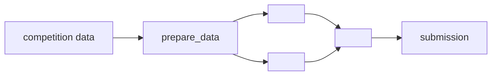

# solution/README.md: the final pipeline

For the reader who only wants the best result: what the final submissions are and how to reproduce them, as
commands. The shape follows what winners' repositories share, and the documentation Kaggle asks prize winners for
(hardware, software, data setup, how to train, how to predict, entry points in order).

Fill it from the commands' output: `kgkit final` (the finals and their scores), `kgkit ledger lineage <final>` (the
chain of kept changes behind each), `kgkit ledger show <id>` (members, params, `cmd`), the final kernel's
`kernel-metadata.json`, `.kaggle-gm/gpu_runs.jsonl` (GPU hours). Every command below is one a record ran (`cmd`) or
says it was reconstructed.

````markdown
# Final solution

<One sentence: what the final submission is, e.g. "an L2 logistic-regression stack of 319 OOF members, nested CV".>
Private <score>, rank <rank> / <teams>. How it was reached: [`../journey/`](../journey/README.md).

## Pipeline



<Two to four sentences on each block that is not obvious: the labels, the validation, the key model choice.>

## The finals

| Final | What it is | CV | Public | Private | Code |
|---|---|---:|---:|---:|---|
| <id> | <one line> | <cv> | <public> | <private> | [<commit>](<link>) |

The chain of decisions behind <id>: <id 1> → <id 2> → … (`kgkit ledger lineage <id>`).

## Hardware and time

- Training: <GPU / CPU, RAM>; <hours per model, total GPU hours>.
- Inference: <time, against the limit in a code competition>.

## Setup

```bash
pip install -r solution/requirements.txt      # versions the pipeline ran with
kaggle competitions download -c <slug> -p data && unzip -o data/<slug>.zip -d data   # accept the rules first
```

The competition data is not in this repository. <Any external dataset or weights: where to get them, their license.>

## Reproduce

Run from the repository root, in order:

| Step | Command | Output | Time |
|---|---|---|---|
| 1. Prepare | `<command>` | `<files>` | <time> |
| 2. Train <model> | `<command>` | `artifacts/<id>/` | <time> |
| 3. Blend | `<command>` | `subs/<id>.csv` | <time> |
| 4. Predict (Kaggle) | `<kernel or command>` | `submission.csv` | <time> |

<Shortcuts a reader can take: trained weights to download, a step whose output is provided.>

## Entry points

| File | What it does |
|---|---|
| `<path>` | <one line> |
````
